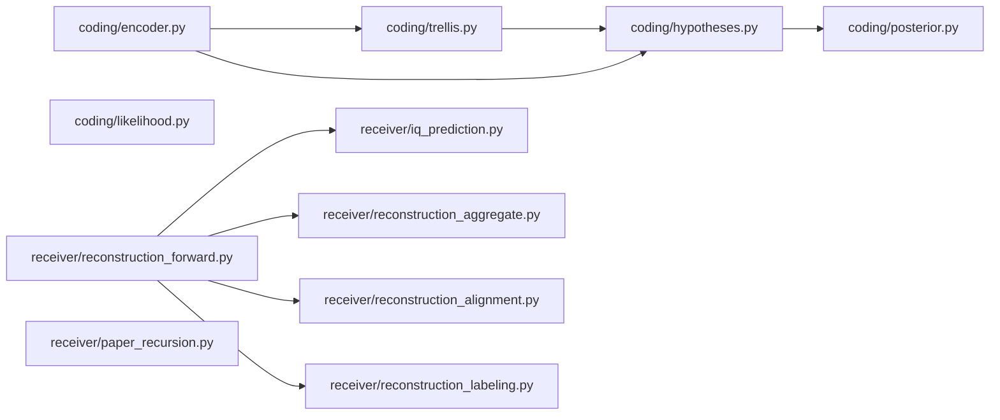

# M4.5c — контракт інтеграції математичних ядер

Цей аудит описує фактичні API наявних M4 модулів та межі їхнього зіставлення з [A] 2026 року. Він не додає зв'язків між алгоритмами й не засвідчує paper-exact receiver.

## Першоджерела, перевірені безпосередньо

- **[A](1), (2):** `references/key_pages/page-4.png`, друк. с. 4. (1) містить posterior-зважену інновацію з межою суми `m`; (2) — мінімізацію накопиченої суми квадратів.
- **[A](5):** `references/key_pages/page-5.png`, друк. с. 5. Надруковано `U_s,1 = μ_1·[-sin(b·Δφ)]`, `U_s,2 = μ_2·cos(b·Δφ)`, `Δφ=π/4`.
- **[B](7):** `references/Автореферат_1-1.pdf`, друк. с. 6 (PDF p. 8). Візуально перевірено нормування двох станів, експоненту з додатним множником `C` перед сумою L2-норм I/Q залишків та перехідну суму.
- **[B](15):** той самий PDF, друк. с. 10 (PDF p. 12). Підтверджено структуру рекурсії оцінки та залежність прогнозованого `U⁰` від попередніх оцінок і дискретного параметра.
- **[B](20):** той самий PDF, друк. с. 11 (PDF p. 13). Підтверджено суму квадратів залишків за часовими інтервалами, променями, відліками та квадратурами.

Формули [B](7),(15),(20) є доказом запису й контексту [B]. Вони не визначають відсутні параметри та індексації [A].

## Таблиця фактичних API

У таблиці `L` — кількість променів у формулах, `M` — авторська кількість станів/кандидатів (значення й відповідність коду не встановлені), `H=16` — лише кількість локальних рядків M4.1, `K` — довжина наданого залишкового вектора, `T` — кількість часових позицій у зовнішніх даних. Якщо одиниці не встановлює джерело/API, це зазначено явно.

| Модуль / виклик | Входи та форми | Виходи та форми | Часовий індекс / одиниці | Походження та межа джерела |
|---|---|---|---|---|
| `coding/hypotheses.py::build_hypotheses()` | Аргументів немає; використовує encoder/trellis. | Tuple із `H=16` `Hypothesis`: `current_state`, `input_bits`, `output_bits`, `next_state`, `hypothesis_id`. | Часу й фізичних одиниць немає; локальний рядок `0…15`. | Проєктна таблиця 4 станів × 4 входи з M1 trellis. ID навмисно не оголошений авторським `θ` чи `α`. |
| `coding/hypotheses.py::is_allowed_transition(...)` | Явні current/input/next state. | `bool`. | Структурна належність гілки, без часу/ймовірності. | Перевіряє M1 trellis; не повертає вагу переходу. |
| `coding/posterior.py::build_allowed_transition_matrix()` | Аргументів немає; читає `HYPOTHESES`. | `uint8`, форма `(H,H)=(16,16)`, структурні `0/1`. | Один крок між рядками гіпотез; одиниці виміру немає. | Ребро `i→j` дозволено за рівності `next_state(i)==current_state(j)`. Це не авторська матриця ймовірностей `π`. |
| `coding/posterior.py::posterior_update(prior,T,likelihoods)` | `prior: (H,)`, рядково-стохастична `T: (H,H)`, `likelihoods: (H,)`, усі явні. | Нормований posterior `(H,)`. | Один абстрактний Bayes крок; ймовірності безрозмірні; часові мітки відсутні. | Загальна log-space рекурсія. 16-вимірність успадкована від M4.1; не доведена як авторські `M` стани. |
| `coding/likelihood.py::log_likelihood_component(r_I,r_Q, coefficient_c=C)` | `r_I,r_Q: (K,)`, однакова ненульова довжина; `C` — явний скаляр. | Скаляр `C·Σ_{k=1}^K hypot(r_I[k],r_Q[k])`. | Елементи масиву — відліки, але `k` і початкова/кінцева мітки не передаються. Розмірність `C` у фізичних одиницях джерелом не вказана. | Лише компонент показника [B](7); знак `C` не закодований. Не повертає `exp(·)`, повний `V` чи вектор likelihood. Не доведено як likelihood [A]. |
| `receiver/iq_prediction.py::iq_quadratures_from_index(b,mu1,mu2)` | Один промінь: цілісний `b` та `μ₁,μ₂` скаляри. Кілька: однакові 1-D форми `(L,)`; кожне `b∈{0,…,7}`. | Один промінь `(2,)`, багато `(L,2)`, last axis `(j=1,j=2)`. | `b` — безрозмірний фазовий індекс; `Δφ=π/4` rad. Коефіцієнти/виходи API не мають заданої фізичної одиниці. Часового індексу немає. | Буквальна алгебра [A](5). `b` і коефіцієнти — явні; функція не формує їх з гіпотези, часових оцінок чи ChannelTruth. |
| `receiver/paper_recursion.py::update_quadrature_estimates(...)` | Один промінь: previous, `K̃`, `U`, `μ₀` `(2,)`, posterior `(M,)`, predictions `(M,2)`. Пакет: `(L,2)`, `(L,M)`, `(L,M,2)`. `α′` скаляр. | Нова флуктуюча й повна оцінки форми `(2,)` або `(L,2)`. | Формула джерела оновлює індекс `i→i+1`; API не приймає часу/відліків. Коефіцієнти не мають фізичних одиниць у контракті функції. | Ізольована алгебра [A](1)/[B](15). Модуль вимагає posterior-нормування, але не визначає ні його, ні `α′`, `K̃`, `μ₀`, observations чи predictions. Форма `observed_iq=(L,2)` сама по собі не доводить вимірюваність per-path. |
| `decoding/paper_metric.py::compute_paper_metric(...)` | Явні `r`, `η`, `f_indices=(r−η,…,r)`; `observed_iq` та `predicted_iq` як вкладені per-f/per-ray сегменти `(N_l,2)`; per-f/per-ray `sample_indices`; inclusive `sample_bounds` по променях. Довжина `N_l` може бути різною між променями. | Один scalar `F(r)` для однієї вже заданої траєкторії. | `f` — явна символічна мітка, offset рядка `f−(r−η)`; `i` — явна мітка відліку, offset рядка `i−i′[l]`; `j=1,2` — остання вісь offset `0,1`. Часові одиниці й фізичне відображення sample-to-symbol не задані API. | Незалежна сума квадратів [A](2), перевірена структурою [B](20). Вхідні спостереження/прогнози вже мають бути вирівняні caller-ом; жодного отримання per-path вимірів, формування `U**`, `argmin`, traceback чи інтеграції немає. **Exact algebraic metric kernel, NOT integrated author receiver.** |
| `receiver/reconstruction_aggregate.py::sum_estimated_path_predictions(path_predictions)` | Явні estimated path predictions рівно форми `(L,N,2)`, де `L,N>0`; жодного broadcasting. | Aggregate prediction `(N,2)`; остання вісь `(I,Q)`. | Усі `N` позицій caller-ом уже вирівняні; API не приймає індексів, delays чи timebase. | Project-side сума явно переданих receiver estimates. Це не per-path вимірювання і не результат від `ChannelTruth`; модуль не будує forward model. |
| `receiver/reconstruction_aggregate.py::compute_project_reconstruction_metric(received_iq,predicted_iq)` | Aggregate received і predicted arrays однакової форми `(N,2)`, `N>0`, explicit inputs. | Scalar `project_reconstruction_metric = Σ_{n,j}(received−predicted)²`. | `n` — тільки позиція узгодженого caller-owned масиву; остання вісь `(I,Q)`. Фізичні одиниці/timebase відсутні. | Проєктна reconstruction metric над aggregate I/Q. Це не [A](2): там залишки мають окремі path-indexed operands. Не використовує `paper_metric.py`, ваги, нормування чи likelihood. |
| `receiver/reconstruction_forward.py::predict_reconstructed_aggregate_iq(...)` | Candidate output bits `(S,3)` у порядку `(c2,c1,c0)`; estimated coefficients `(L,2)` = per-path `(μ₁,μ₂)`, сталі на кадр; delays `(L,)`; explicit symbol origin, output frame, labels, named timebase/sample rule та edge policy. | Aggregate predicted I/Q `(N,2)`; internally local per-ray symbols `(S,2)`, rectangular-expanded segments `(L,8S,2)`, alignment `(L,N,2)`. | Symbol `s` covers absolute sample labels `origin+8s…origin+8s+7`; frame output row `n` labels `frame_start+n`. Delays shift each segment by explicit integer samples. | Project reconstruction baseband forward model composing the labeling, [A](5) I/Q, alignment and B2a aggregation APIs. Coefficients are caller-supplied; no `ChannelTruth`, passband waveform, estimator, likelihood, posterior or search. **NOT paper-exact prediction/receiver.** |

`likelihood.py` фактично лежить у `src/hf_tcm/coding/likelihood.py`, не в `receiver/`. Це самостійна функція без залежностей від інших M4 модулів.

## Граф залежностей

### Фактичні імпорти коду



У межах перелічених M4 модулів `posterior.py` імпортує `hypotheses.py`; M4.7g `reconstruction_forward.py` композиційно імпортує labeling, I/Q, alignment і aggregate helpers. Цей викликний ланцюжок — project reconstruction, а не підтверджений авторський тракт. Зв'язки нижче позначають інші невирішені dataflow, а не наявні виклики:

```mermaid
flowchart LR
    RX[received aggregate samples] -. "невідоме розділення променів та I/Q" .-> U[per-path U input required by A(1)]
    H[hypotheses output_bits] -. "b(theta) mapping невідомий" .-> I[iq_prediction]
    EST[explicit coefficient estimates] --> I
    I -. "лише умовний кандидат U0" .-> RES[aligned residuals]
    U -. "per-path provenance unresolved" .-> RES
    RES -. "B(7) component only" .-> L[likelihood component]
    P[posterior_update] -. "shape/index mapping unresolved" .-> R[paper_recursion]
    L -. "requires exponentiation and candidate vector" .-> P
    I -. "predicted_iq input" .-> R
```

Пунктир позначає не реалізовані та/або науково не підтверджені зв'язки. Жоден граф не стверджує, що [B](7) є likelihood статті [A].

## Перевірка походження per-path спостережень і `ChannelTruth`

1. [A](4), друк. с. 5, задає сумарний прийнятий пассбенд сигнал як суму внесків променів і шуму. [B](15) використовує path-indexed `U^{(l)}_{j,i+1}`. Формули на цих сторінках не доводять, що приймач без додаткової операції окремо вимірює кожен шляховий доданок.
2. M4.4 приймає `observed_iq` форми `(L,2)`, але не отримує її з raw received samples і не має аргументу-джерела/метаданих походження. Це вимога форми проєктного API, а не доказ поділу променів.
3. `ChannelTruth` у `channels/multipath.py` — діагностичне поле `ChannelOutput`, окреме від `received`; воно містить channel coefficients і конфігуровані path delays/powers/K. Перелічені M4 модулі його не імпортують. Отже, **у поточних реалізаціях немає фактичного підставляння `ChannelTruth` у M4**, але немає й інтеграційного адаптера, який гарантує допустиме походження `observed_iq`.
4. Межа майбутнього оцінювача має приймати лише одержані вимірювання/їхні receiver-side перетворення та явно передані оцінки станів. `ChannelTruth` може лишатися тільки на незалежному симуляційному evaluation path. Передача його coefficients як `μ̂`, або формування `observed_iq` з відомих path contributions, буде витоком truth, а не оцінюванням.

Тому пер-path спостереження в `paper_recursion.py` зараз є явним математичним входом із невідомим фізичним джерелом. Їх не можна описувати як отримані виміри до специфікації path separation.

## Авторські вимоги проти фактичних API

| Авторська вимога | Статус API | Розрив для інтеграції |
|---|---|---|
| [A](1): posterior над кандидатами `θ^{(l),α}`, сума `α=1…m`, path-specific попередній стан, `U` та `U⁰`. | Posterior API фіксований на 16 M4.1 hypotheses; recursion приймає абстрактні `M` та явні масиви. | Немає відображення `hypothesis_id↔θ↔α`, узгодження `m/M`, likelihood [A], часових міток, або достовірного per-path observation source. |
| [A](5): quadrature values за числовим `b` та коефіцієнтами променя. | `iq_prediction.py` обчислює тільки `μ₁[-sin(bπ/4)]`, `μ₂cos(bπ/4)` для явно заданих входів. | Не встановлено `output_bits→b`, як оцінюються/оновлюються коефіцієнти, і чи ці значення саме `U⁰` для (1). |
| [B](7): `V` = експонента від `C·Σ norm` × сума transition × prior, із нормуванням posterior. | Likelihood модуль віддає лише `C·Σ norm`; posterior окремо приймає звичайний невід'ємний likelihood vector і перехідну матрицю. | Немає піднесення до експоненти й складання за кандидатом у єдиній функції; числові `C`, prior та transitions невідомі. Навіть повне складання [B](7) не доводить модель [A]. |
| [B](15)/[A](1): обновити флуктуючу оцінку path coefficients posterior-зваженими innovations і додати regular component. | `paper_recursion.py` реалізує алгебраїчну форму при всіх явно заданих масивах. | Інтеграція не визначає параметри, джерела prediction/observation, posterior або часову синхронізацію; це не повний estimator. |
| [A](2): мінімізувати squared residual за спільним рішенням на окні глибини `η=20`. | `paper_metric.py` обчислює буквальну scalar суму квадратів для однієї поданої траєкторії; M2 Viterbi окремий. | Kernel не реалізує зовнішній `argmin`, авторське маркування `θ`, формування `U**` або визначення physical sample intervals. |

## Контракт незалежного metric kernel [A](2)

У скані [A], друк. с. 4, записано структуру

\[
\theta^*_{r-\eta}=\arg\min_{\theta}F(r)
=\arg\min_{\theta_{f[l]=f}}
\sum_{f=r-\eta}^{r}
\sum_{l=1}^{L}
\sum_{i=i'^{[l]}}^{i''^{[l]}}
\sum_{j=1}^{2}
\left[U^{(l)}_{j,i}-U^{**,(l)}_{j,i}(\alpha)\right]^2,
\qquad \eta=20.
\]

Розшифрування сумування для окремого чистого kernel:

- `r` — явний поточний тактовий інтервал; `η=20` задано [A], с. 6. Межа по `f` включна з обох боків: `f=r−20,…,r`, тобто **21** значення `f`.
- Для кожного `f` сумуються всі промені `l=1,…,L`.
- Для кожного променя додаються відліки `i=i'^[l],…,i''^[l]`, також включно з обома індексними межами. Саме такі межі надруковані в (2). Як вони обчислюються з часової дискретизації, затримок і меж кадру, формула не визначає; kernel має одержувати їх/вирівняні дані явно, а не вигадувати.
- Для кожного відліку сумуються рівно дві квадратури `j=1,2`.
- Кожен залишок **підноситься до квадрата до сумування**. Немає квадратного кореня, нормування на число елементів, множника `C`, likelihood, prior або transition matrix.
- Мінімізація охоплює сумісні послідовності `θ` з обмеженням `θ_{f[l]=f}` у записі автора. Обчислення мінімуму/traceback по trellis — поза незалежним скалярним metric kernel.
- `U**` не можна автоматично ототожнити ані з `U⁰` із (1), ані з умовним виходом `iq_prediction.py`: [A](2) пояснює `U**` як величини, зумовлені оцінками завмирання та можливими станами, але інтегральне відображення в коді не встановлене.

[B](20), друк. с. 11 (PDF p. 13), підтверджує аналогічну структуру накопиченої суми квадратів за `f,l,i,j`. Вона не замінює межі чи prediction для [A] і не додає до [A] своїх блокових конвенцій.

## Невідомі зв'язки, що залишаються

1. **Гіпотези:** як `M`, мала межа `m`, `θ`, `α`, `β` і 16 рядків `HYPOTHESES` співвідносяться; чи існує авторське однозначне маркування гілок.
2. **8PSK labeling:** як саме `output_bits=(c₂,c₁,c₀)` дає `b`; ні `hypothesis_id`, ні natural-binary профіль не підтверджені як [A].
3. **Posterior/likelihood:** точна likelihood для [A], перехідні `π` (значення й орієнтація), початковий posterior, значення/знак `C`, а також межі `m` проти `M`.
4. **I/Q:** чи умовне перетворення [A](5) з коефіцієнтами оцінювача є саме `U⁰` з (1), з якого часу ці коефіцієнти та як вони оцінені без truth.
5. **Path observations:** як утворити `U^{(l)}_{j,i}` із сумарного received waveform; специфікація демодуляції, поділу й компенсації променів та відсутності truth leakage.
6. **Час/одиниці:** узгодження `i` і `i+1`; `τ_l` у секундах проти проєктного `delay_samples`; число відліків на символ, межі кадру та відображення `i'^[l],i''^[l]` у реальні масиви.
7. **Metric inputs:** побудова `U**` для кожного candidate sequence та зв'язок його індексу `α` з рішенням `θ`. Незалежний kernel може тільки агрегувати вже вирівняні величини.
8. **Параметри рекурсії:** `α′`, `K̃`, initial/fluctuating/regular states для повного [A](1) estimator.

Ці прогалини відповідають відкритим SCI-02…04 та пунктам `docs/M4_OPEN_QUESTIONS.md`. Збіг структури формул [B] не розв'язує їх за статтю [A].

## Реалізація та готовність M4.6

### M4.6 — чистий metric kernel: **READY — IMPLEMENTED**

Ізольований scalar kernel реалізовано в `src/hf_tcm/decoding/paper_metric.py`. Він приймає caller-ом вирівняні I/Q сегменти, явні `f`/`i` мітки й per-ray inclusive bounds, обчислює суму квадратів зі стійким сумуванням і перевіряє форми/межі. `η` передається явно; при `η=20` функція перевіряє рівно 21 позицію `f=r−20,…,r`. Тести покривають включність меж, обидві квадратури, різні довжини сегментів променів і ручні суми. Це не створює `U**`, не призначає авторські `θ` чи гіпотезне маркування і не виконує мінімізацію.

### M4.7 — повна інтеграція: **BLOCKED**

Інтеграція має чекати, доки буде визначено labeling/гілка→`θ` (SCI-02), posterior, likelihood, часові коефіцієнти й початкові оцінки (SCI-03), а також шляхову модель, затримки й вимірювальний тракт без ChannelTruth (SCI-04). Окремо потрібні явний зв'язок `U**` із predictor та синхронізовані `i'^[l],i''^[l]`. Не створювати інтеграційних заглушок, що маскують ці невідомі.

## M4.7e/B2a — ізольована aggregate-I/Q arithmetic

`receiver/reconstruction_aggregate.py` приймає `(L,N,2)` уже обчислених receiver-side estimated path predictions і компонентно сумує вісь `L` через стійке сумування. Вхід має ненульові `L,N`, скінченні дійсні значення; broadcasting, delay alignment і зміни вхідних масивів відсутні. Окрема функція приймає тільки явні aggregate `received_iq` і `predicted_iq` форми `(N,2)` та обчислює невід'ємну суму квадратів residuals.

Назва критерію — **`project_reconstruction_metric`**. Його operands є aggregate I/Q, на відміну від path-indexed `U^{(l)}` у [A](2); тому це не `paper_exact_metric` і модуль не делегує обчислення до `decoding/paper_metric.py`. Передані path arrays позначають тільки estimated candidate predictions: це не вимірювання окремих променів і не симульовані path contributions. `ChannelTruth` не є аргументом і не імпортується.

**Межа:** реалізована лише сума та residual arithmetic для вже вирівняних даних. Forward model, `b`/labeling, timebase, sample delays, coefficient estimates, candidate sequencing, likelihood/posterior, traceback і pipeline не реалізовані. `paper_exact` лишається `false`, `receiver_enabled` — `false`. На цьому історичному етапі ADR-003/004/005 ще були proposed; їх прийнято окремим рішенням 2026-10-28 у M4.7o.

### Повний B2b — інтеграційна готовність: **BLOCKED**

Проєктні decision gates ADR-002/006/007/008/010 прийняті. Ізольований B2b-2 формує project prediction із caller-supplied inputs; повний receiver залишається заблокованим per-path observation rule (ADR-011 proposed), config-driven frame/edge setup і posterior/likelihood/decoder decisions. B2b-1 лише вирівнює segments; B2b-2 не оцінює coefficients і не запускає search.

## M4.7f/B2b-1 — ізольований integer-sample alignment

`receiver/reconstruction_alignment.py::align_estimated_path_predictions` тепер приймає окремі nonempty `(N_l,2)` estimated I/Q segments, nonnegative absolute segment starts, explicit nonnegative integer sample delays, explicit output frame start/count та explicit `edge_policy="zero_padding"`. У проєктній конвенції input offset `k` маркується як `start_l+k`, після delay — `start_l+k+delay_l`; output row `n` має label `frame_start+n`. Перекриваючіся sample labels копіюються; поза-frame input обрізається; output позиції без покриття є нулями. Вихід `(L,N,2)` безпосередньо передається B2a aggregator-у. Немає припущення про 8 samples/symbol і немає автоматичного `τ_l` conversion.

Це project-reconstruction buffer placement, не доведена часова модель [A]. Delay sign convention свідомо збігається з наявною M3 integer delay реалізацією `apply_multipath` (внесок зміщується вперед), але не оголошується авторською конвенцією. Жодні path predictions або delays не беруться з `ChannelTruth`.

**Статус:** B2b-1 — **READY — IMPLEMENTED** як ізольований оператор і ручні тести, включно з композицією aligned `(L,N,2)` → B2a aggregate `(N,2)`. Його використовує B2b-2 для explicit inputs за `approximate_rectangular_8sps`, integer delays, frame boundaries і `zero_padding`. B0 schema не має окремих полів edge policy/frame start/count; вона не змінена, тому config-driven receiver лишається disabled. Source-faithful і paper-exact режими не змінені.

## B2b-2 — gate

**Закрито для ізольованого project reconstruction forward-prediction kernel** після реалізації M4.7g; це не відкриває інтегрований pipeline. На той етап ADR-003/004/005 ще не прийняті; у M4.7o прийнято лише їхню project posterior policy. B3b/B4 orchestration та decoder залишаються окремими етапами.

## M4.7g/B2b-2 — project reconstruction forward model

`receiver/reconstruction_forward.py::predict_reconstructed_aggregate_iq` повторно використовує explicit output-bits labeling adapter, [A](5) I/Q kernel, B2b-1 delay/frame alignment і B2a aggregate sum. API вимагає profile `assumed_natural_binary`, order `(c2,c1,c0)`, timebase `approximate_rectangular_8sps`, rule `rectangular_zero_order_hold_8_samples_per_symbol`, `zero_padding`, символний origin, frame bounds, integer delays та coefficients `(L,2)`.

Коефіцієнти `(μ₁,μ₂)` — лише caller-supplied receiver-side estimates, одна пара на промінь, стала для всього переданого кадру; ні per-symbol, ні sample-indexed варіанту немає. Кожен output triple дає `b` через прийнятий reconstruction mapping. Фазовий крок [A](5) дорівнює `π/4`; додаткового phase offset немає. Кожен local I/Q symbol повторюється рівно на 8 sample positions, path delay зсуває segment вправо, frame clip/padding виконує B2b-1, після чого B2a складає `(L,N,2)` у `(N,2)`.

**Статус:** **PROJECT RECONSTRUCTION forward model — READY — IMPLEMENTED** як ізольована функція. Це baseband prediction, не passband waveform [A](3)–(6), не твердження `U⁰=U**` і не paper-exact receiver. B0 config не запускається й не змінюється: функція вимагає всі convention/frame values явними параметрами; наявний config validator лишає `receiver_enabled:false`, `paper_exact:false`, а source-faithful відхиляє reconstruction settings. Конфігураційний/pipeline dispatch не доданий.

### M4.7h/B3a та B3b/B4 — межі стану й залишкові блокери

- **B3a state contract:** ADR-007 accepted — конфігурація явно містить `alpha_prime`, `k_tilde`, `mu0`, початкові fluctuating/full I/Q estimates кожного променя, provenance та `initial_time_index`. За [A](1)/[B](15), `fluctuating_iq` відповідає флуктуючій `\(\widetilde{\mu}^{*}\)`, `full_iq` — повній `\(\mu^{*}\)`, а `mu0` — окремій регулярній складовій. `ReconstructionEstimatorState` є лише immutable snapshot `(L,2)` + absolute index.
- **B3b-0 explicit state step:** `advance_reconstruction_estimator_state()` підтримує `L=1`, приймає всі операнди й індекси явно, перевіряє `state.time_index=i`, `next_time_index=i+1`, адаптує single-beam arrays до фактичної batched форми й делегує числовий крок `paper_recursion.py`. Повертає новий snapshot; старий не мутується. Це isolated explicit-operand reconstruction adapter, **NOT paper-exact estimator**. Жодного автоматичного спостереження, posterior, likelihood, prediction чи пошуку немає.

## M4.7n/B3c-4 — causal ADR-012 bridge

ADR-012 was explicitly accepted by the user on 2026-10-28 for the narrow `reconstructed_offline`, L=1, real-channel, zero-delay, 8-sample rectangular-ZOH profile. `reconstruction_observation.py` maps each selected complex sample to `(-Im,Re)` and averages exactly the eight absolute labels of an explicitly supplied symbol. `reconstruction_causal_step.py` accepts a pre-observation estimator time and absolute symbol index as separate explicit labels, delegates one state step with explicit posterior/prediction/parameters, then returns a full-IQ snapshot for the next symbol or later. The adapter does not derive or map clock origins and cannot use future samples.

This remains **causal one-path explicit-posterior reconstruction step, NOT complete paper-exact receiver**. No posterior integration, general complex-channel/noise model, frame scheduling, B4, CLI or pipeline integration is added. Forward coefficients stay constant within a frame; `paper_exact:false`, `receiver_enabled:false`; ADR-011 stays proposed.
- **B3c-0 explicit-operand sequential reconstruction estimator:** `run_reconstruction_estimator_sequence()` приймає початковий immutable state і послідовність кроків з явними operands/absolute clock labels. Runner передає кожен крок до B3b-0; пропущені, повторені, переставлені timestamps відхиляються вимогою `i→i+1`. За запитом повертає tuple history з початкового й кожного наступного state. Кожне оновлення використовує попередню fluctuating estimate, а `full_iq` дорівнює її оновленому значенню плюс `mu0` саме цього кроку. Це **explicit-operand sequential reconstruction estimator, NOT complete paper-exact estimator**.
- **B3c-1 state-to-forward snapshot:** `snapshot_full_iq_for_forward()` робить immutable копію саме `state.full_iq (1,2)` і вимагає явний `estimator_time_index`, рівний мітці state. Це лише явний value/timestamp adapter до coefficient shape `reconstruction_forward.py`; він не встановлює, якому sample/symbol/frame відповідає цей tick.
- **B3c-2 baseband compatibility:** M3 unit 8PSK baseband має `x_b=cos(bπ/4)+j sin(bπ/4)`, а [A](5) — `(-μ₁ sin(bπ/4), μ₂ cos(bπ/4))`; raw `(Re,Im)` не дорівнює [A](5). Oracle equalization in that compatibility audit was only a test control, not production input.
- **B3c-3 real-channel control:** for synthetic `h=a∈ℝ`, equal coefficients, no noise/delay, `(-Im(received),Re(received))` matched [A](5) at all eight phases for two `a` values; complex `h` gives counterexamples.
- **B3c-4 current status:** ADR-012 now accepts the exact eight-sample mean and causal symbol cutoff. See the current contract above. It remains a narrow project assumption; the general complex/noise model and autonomous estimator are blocked.
- **Clock/causality:** sample, symbol та estimator indices — окремі labels; існуючий `i→i+1` не означає sample-level або symbol-level. Для causal prediction snapshot і всі posterior/predictions мають бути доступні на cutoff прогнозу; майбутні received samples для минулої метрики/state вимагають окремо задекларованого smoothing regime. `reconstructed_offline` саме по собі такого режиму не визначає.
- B3c-0 не отримує `observed_iq` із aggregate `received`, не генерує candidates, predictions, likelihood, posterior чи pseudo-path observations, і не зберігає `ChannelTruth`. Він не підключений до `reconstruction_forward.py`, CLI, pipeline чи decoder; кадрова конвенція B2b-2 лишається незмінною.
- **B3b coefficient/observation path:** ADR-011 proposed — відсутнє визначене per-path observation operand та правило його формування з aggregate `received` I/Q. Також потрібні posterior `(L,M)`, predictions `(L,M,2)`, часовий alignment до absolute recursion index, noise/correlation handling та спосіб перетворити B2b-2 сталі `(L,2)` frame coefficients на еволюційний coefficient source. ADR-007 сам цих рішень не задає.
- **B4 inference/decoder:** після M4.7o ADR-003/004/005 задають лише ізольовані project transition/prior/pseudo-likelihood choices. Їхній posterior adapter не підключений до causal step. ADR-009 search/traceback лишається proposed; source-level candidate mapping і metric generation також залишаються поза adapter-ом.

## M4.7o/B4a — isolated reconstruction posterior adapter

ADR-003/004/005 were explicitly accepted by the user on 2026-10-28 only as project choices. `receiver/reconstruction_posterior.py` builds row-stochastic probabilities from the actual 16×16 structural mask, creates an initial prior from `current_state=(0,0)`, computes stable shifted weights from explicit nonnegative aggregate metrics and beta, and delegates transition-plus-emission updates to `coding.posterior.posterior_update()`.

The initial prior `π₀` is already the distribution over the first edge. Its first emission updates directly as `p₀(h)∝π₀(h)L₀(h)` with no transition. For each later edge `t≥1`, the adapter predicts `q_t(k)=Σ_h p_{t−1}(h)T[h,k]`, then applies the metric emission `p_t(k)∝q_t(k)L_t(k)`. This adapter does not integrate with symbol timing or the causal coefficient step. `F_rx` is an aggregate project reconstruction metric, not `paper_metric.py`/[A](2); the pseudo-likelihood is not a proved statistical model. Result: **isolated reconstruction posterior adapter, NOT author-exact posterior, NOT integrated adaptive receiver**. SCI-02/03 and SCI-METRIC-02 remain open; ADR-009/011 proposed. **At the B4b stage this integration was BLOCKED** pending explicit per-symbol candidate-metric ordering and cutoff mapping; M4.7q/B4c below implements the isolated one-symbol bridge.

## M4.7p/B4b ? isolated causal reconstruction candidate-metric generator

`receiver/reconstruction_candidate_metrics.py::generate_reconstruction_candidate_metrics()` evaluates all 16 local edge hypotheses for one explicitly labelled symbol under the accepted narrow reconstruction profile: `reconstructed_offline`, L=1, zero delay, rectangular ZOH, and 8 samples/symbol. It accepts an explicit pre-observation `ReconstructionEstimatorState`, a matching explicit `time_index`, the target absolute `symbol_index` and sample origin, a complex aggregate received buffer with contiguous absolute sample labels, and the exact profile conventions. It rejects incomplete windows and any profile outside ADR-012.

Hypothesis ordering defaults to `coding.hypotheses.HYPOTHESES` and is checked against `reconstruction_posterior.py`'s canonical 16-ID ordering. For each row, the generator reads `output_bits`, maps them through `assumed_natural_binary` and `OUTPUT_BIT_ORDER`, then reuses the existing forward model. `hypothesis_id` identifies metadata rows only; it is never used as a phase index. A caller may request a permutation of IDs; metrics and their output-bit/phase metadata are permuted together.

Prediction uses `state.full_iq (1,2)` from before the current observation. For each candidate the existing forward model produces `(8,2)` I/Q at the target symbol's absolute sample labels. ADR-012 maps each received complex sample to `(-Im, Re)`, yielding an observed `(8,2)` array. The existing `compute_project_reconstruction_metric` returns `F_rx,h = sum_k sum_j (Y_j[k]-Yhat_j[h,k])^2`; the eight sample residuals are not reduced to the estimator recursion's averaged `(2,)` operand. The returned immutable metric vector has shape `(16,)` and metadata includes IDs/order, candidate output bits, phase indices, sample labels, target symbol/time indices, pre-observation prediction cutoff, metric-availability sample and ADR-012 profile ID.

The generator constructs every candidate prediction from the pre-observation snapshot before reading the selected received values. Predictions for symbol `f` are therefore labelled as available before its first sample (`O+8f-1`); the resulting metric becomes available only after `O+8f+7`. The pre-state timestamp must equal the explicitly supplied estimator `time_index`; no implicit mapping from estimator ticks to symbol indices is made. Future buffer values are not included in the selected observation window.

The vector is sufficient as the per-edge metric operand for the isolated B4a posterior adapter: its 16 values align with the 16-edge hypothesis order. It is not a complete information-bit decoder. It does not perform multi-symbol state/path search, trellis traceback, termination handling, or map a selected path back to information bits. No posterior, likelihood, coefficient update, candidate trajectory, decoder, CLI, or pipeline is invoked here. Result: **isolated causal reconstruction candidate-metric generator, NOT paper-exact metric, NOT autonomous adaptive receiver**. `paper_exact:false`, `receiver_enabled:false`; SCI-METRIC-02 remains open; ADR-009/011 remain proposed.

## M4.7q/B4c ? isolated posterior-to-estimator symbol step

`receiver/reconstruction_posterior_estimator_step.py::process_reconstruction_posterior_estimator_step()` composes the existing B4b candidate metrics, B4a posterior adapter, ADR-012 observation bridge, [A](1) state-step adapter and next-symbol snapshot for one `reconstructed_offline`, L=1, real-channel, zero-delay, 8-sample rectangular-ZOH symbol. It does not run a sequence or connect CLI/pipeline.

The caller explicitly selects `edge_mode="first_edge"` and supplies `initial_prior` (with `previous_posterior=None`), or selects `edge_mode="later_edge"` and supplies `previous_posterior` (with `initial_prior=None`). First-edge semantics are `normalize(initial_prior * L_current)` with no transition. Later-edge semantics are B4a's `transition(previous_posterior)` followed by the current metric likelihood. Both return the posterior for the current edge. A prior/posterior's zero support is preserved by B4a; the estimator step receives the normalized current posterior in canonical hypothesis order.

The step freezes pre-observation `full_iq`, then obtains B4b metrics and their canonical hypothesis/output-bit/phase metadata. It computes the `(16,2)` recursion prediction array with existing `iq_quadratures_from_index()` from those phases and the same pre-state `full_iq`. The B4b immutable `(16,8,2)` sample predictions must equal repeating each recursion prediction across the eight ZOH samples (checked with `rtol=atol=1e-14`). This is a direct consistency check between existing kernels, not a new signal model. It then delegates observation extraction and the single `i -> i+1` update to `advance_real_one_path_symbol()`; the current posterior is never used to regenerate current candidate metrics or predictions.

Inputs explicitly include estimator `time_index`, absolute `symbol_index`, `symbol_origin_sample`, contiguous sample labels, prediction cutoff and posterior cutoff. The mapping between `i` and `f` remains caller-supplied. For `O+8f` as the first current sample, the required prediction cutoff is exactly `O+8f-1`; posterior/observation cutoff is exactly `O+8f+7`. The returned state has estimator index `i+1`, becomes usable only at symbol `f+1` or later, and its forward snapshot copies `full_iq`.

The result is **isolated causal single-path reconstruction posterior-estimator step, NOT paper-exact receiver, NOT decoded-bit output**. B4c's one-step integration gate is READY under the explicit accepted project assumptions. Autonomous sequence processing still needs a sequence-level clock/initialization and buffering policy. B5/B6 remain blocked on decoder/search/traceback/termination and end-to-end evaluation definitions (ADR-009 remains proposed); no such behavior is inferred here. `paper_exact:false`, `receiver_enabled:false`; ADR-011 remains proposed and SCI-METRIC-02 remains open.

## M4.7r/B4d ? isolated causal posterior-estimator sequence runner

`receiver/reconstruction_posterior_estimator_sequence.py::run_reconstruction_posterior_estimator_sequence()` invokes the existing B4c symbol step once per symbol. It handles only a contiguous complex received buffer containing exactly eight samples per requested symbol in the narrow `reconstructed_offline`, L=1, real-channel, zero-delay, rectangular-ZOH profile. The caller supplies `symbol_origin_sample=O`, an explicit absolute `symbol_indices` schedule, `first_symbol_index`, count, exact absolute labels, initial state and estimator tick. B4c's established mapping is used verbatim: symbol `f` selects samples `O+8f ... O+8f+7`; the buffer must start at `O+8*first_symbol_index`. No frame-local conversion is guessed.

At sequence start, `run_mode="new_independent_sequence"` is an explicit caller declaration that the listed first symbol is the beginning of an independent trellis run; it must equal `sequence_origin_symbol_index` and use the ADR-004 initial prior. First edge gets current likelihood with no transition; subsequent symbols pass exactly the previous symbol's posterior and use one transition then current likelihood. For `run_mode="continuation"`, the caller supplies the preceding completed symbol index, the estimator tick used for that symbol, its posterior, and the next estimator state. The first continuation symbol must immediately follow both predecessor clocks, and it is processed as a later edge. It cannot silently reinitialize a mid-trellis fragment.

Estimator and symbol clocks remain separate. The caller supplies their initial pair `(initial_estimator_time_index, first_symbol_index)`; after each processed symbol both advance by one, with the estimator state timestamp checked at every call. Prediction cutoff is `O+8f-1`; observation/metric/posterior/update cutoff is `O+8f+7`; the successor state is eligible only from `f+1`. Recursive parameters may be explicit constants (`alpha_prime` scalar, `k_tilde/mu0 (1,2)`) or complete per-symbol schedules (`alpha_prime (N,)`, `k_tilde/mu0 (N,1,2)`); `beta` remains explicit and positive. No schedule values are inferred.

The runner passes only each received prefix ending at the current symbol into B4c, then carries forward that step's `next_state` and posterior. It returns final state/posterior/clocks and optionally an immutable tuple of per-symbol diagnostics; no ChannelTruth is accepted or stored. One runner call is one continuous received buffer. Frame segmentation is reporting-only and does not reset state or posterior. Forward predictions remain the B4c symbol-level model; no claim of compatibility with a frame-constant forward schedule is made.

Result: **isolated causal single-path reconstruction posterior-estimator sequence runner, NOT paper-exact receiver, NOT decoded-bit output**. Independent-run and continuation semantics are explicit; no CLI/pipeline, frame scheduler, decoder, BER/SER evaluation or hidden reset is added. B5 still needs frame/edge/delay scheduling and explicit separation of `U0` innovation predictions from `U**` candidate/window predictions. B6 still needs ADR-009 search width/tie-break, survivor lifecycle, termination and traceback; B7/M5 needs paired-seed BER/SER counts, intervals and sensitivity. ADR-009/011 remain proposed; `paper_exact:false`, `receiver_enabled:false`, SCI-METRIC-02 open.

## M4.7u/B5c — isolated B4d to B5b end-to-end composition

See [M4_B5_END_TO_END_INTEGRATION_CONTRACT.md](M4_B5_END_TO_END_INTEGRATION_CONTRACT.md). The adapter runs B4d once for one explicitly labelled independent sequence with immutable history enabled, copies each actual B4c candidate-metric vector into a canonical frozen `(F,16)` matrix, then invokes B5b once. It does not recompute metrics from the final estimator state. B4d's first edge uses the ADR-004 prior and current likelihood without transition; subsequent edges use the previous posterior and one transition. B5b starts from `(0,0)` for this independent sequence, uses free final state, and returns the selected input bits.

The wrapper requires separate absolute sample, absolute symbol, and estimator-time labels and preserves B4d's prediction cutoff `O+8f-1` and metric/update cutoff `O+8f+7`. B4d supports explicit continuation; a caller can join its exact immutable metric histories and make one B5b call, but the wrapper does not stitch fragments. Frame segmentation does not reset state or trellis. This is **isolated end-to-end single-path reconstructed receiver, NOT paper-exact joint receiver, NOT general multipath receiver**. No CLI/pipeline or receiver flag changes; `paper_exact:false`, `receiver_enabled:false`; ADR-009/011 proposed; SCI-02/03/SCI-METRIC-02 and `U0`/`U**` remain open.

## M4.7s/B5a — trajectory contract and conditional-decoder gate

See [M4_B5_TRELLIS_PATH_CONTRACT.md](M4_B5_TRELLIS_PATH_CONTRACT.md) for canonical edge ordering, valid path adjacency, B4b/B4a/path-cost distinctions, explicit clocks and decoder interface. `coding.hypothesis_path.validate_hypothesis_edge_path()` validates only a caller-provided path; it performs no search or decoding.

M1 encoder transitions and all 16 hypotheses match exactly. A full four-state dynamic program is mathematically exact for a frozen time-indexed edge-cost matrix under an explicitly chosen additive objective. B4b's costs are history-conditioned by B4d's causal estimator states, so such a pass is conditional on that frozen history and is not a joint global channel-trajectory optimum. B4a posterior values are not additive branch costs; `[A](2)` remains distinct and SCI-METRIC-02 remains open.

**Historical M4.7s/B5a gate:** at that point B5b was blocked pending an ADR and path-end/tie policy. M4.7t/B5b below supersedes that gate: ADR-013 and the isolated conditional decoder are now accepted/implemented. Remaining B4d-to-B5b orchestration and U0/U**/frame-model questions remain separate and blocked. No beam/traceback depth is inferred from `eta=20`; ADR-009 remains proposed.

## M4.7t/B5b — isolated conditional reconstruction Viterbi decoder

ADR-013 was explicitly accepted on 2026-10-28. `decoding/reconstruction_viterbi.py::decode_reconstruction_viterbi()` decodes one explicitly declared independent `reconstructed_offline` sequence from an already frozen finite, nonnegative `(F,16)` B4b cost matrix. Caller supplies canonical `HYPOTHESES`, initial state `(0,0)`, sequence mode, and separate consecutive labels for path-local edge indices, absolute symbol indices, and estimator time indices. The decoder validates these, does not infer an axis from another, and rejects continuation mode. It accepts no observations, posterior, channel estimate, truth, or B4d orchestration operand.

For each canonical edge `h` at row `t`, it evaluates `D_prev(current_state(h)) + C[t,h]` and retains the minimum at `next_state(h)`. Exact equal costs into one destination select the smallest `hypothesis_id`; final exact ties select the smallest state index in M1 `STATES`. The final state is free. No tails or forced termination are added. Full traceback returns the edge IDs, `(F,2)` `input_pairs`, `(2F,)` information bits, state path, and read-only `(F,4)` survivor and predecessor diagnostics. Overflow in cumulative float64 costs is rejected.

The result is **isolated conditional reconstruction Viterbi decoder, NOT paper-exact joint receiver, NOT integrated adaptive receiver**. It minimizes only the sum of frozen B4b costs, conditional on the causal estimator history used to produce them. It does not optimize unknown channel trajectories jointly and does not use B4a posterior or [A](2) as a substitute cost. A single call processes one independent sequence. To preserve trellis continuity across reporting frames, concatenate their costs/labels in one call; no automatic frame reset/scheduler or B4d-to-B5b pipeline was added. ADR-009/011 remain proposed; ADR-013 accepted; SCI-02/SCI-03/SCI-METRIC-02 remain open; `paper_exact:false`, `receiver_enabled:false`.

## M4.7v/B5d — segmented B4d continuation and one final B5b decode

See [M4_B5_SEGMENTED_DECODE_CONTRACT.md](M4_B5_SEGMENTED_DECODE_CONTRACT.md).
An explicit ordered partition of the complete received buffer is processed by
one initial B4d run and zero or more continuation runs. Each continuation uses
the preceding final estimator state/posterior and preceding symbol/estimator
clock labels; only the first symbol uses the ADR-004 prior. The adapter combines
exact metric rows and posterior diagnostics from B4d history, checks canonical
hypothesis order and absolute cutoffs, then calls B5b once for the entire
independent sequence. Segment boundaries do not reset trellis, estimator, or
posterior.

For deterministic operands the tested F=1,2,4,6 segmentations match monolithic
B5c metrics, posterior history, final state/posterior, decoded path/bits, and
path cost. This is segmentation equivalence evidence for the narrow
reconstructed profile, not general frame-constant forward integration. Reporting
frames remain reset-free groupings. `paper_exact:false`, `receiver_enabled:false`,
ADR-009/011 proposed, and SCI-METRIC-02 open are unchanged.

## M5a — independent BER/SER measurement layer

Added `hf_tcm.evaluation.error_metrics` for strict post-decode counting and
pooling. Information-bit BER compares exactly equal-length `(2F,)` information
bit sequences. Coded-symbol SER compares exactly equal-length `(F,)` 8PSK index
sequences, with reference symbols formed from M1 encoded output bits and
decoded symbols from selected edge output bits through ADR-002. The evaluation
helpers reject malformed values and never trim mismatched suffixes. Pooled
counts are summed before ratios are calculated; per-run records remain the
caller's experiment data.

Reference bits and `ChannelTruth` remain outside receiver APIs. M5a does not
run trials or alter B5c/B5d, M1–M3, `paper_exact:false`, or
`receiver_enabled:false`. M2 matched comparison and any SNR sweep remain
BLOCKED pending a shared received-sample, energy/noise/covariance, and CSI
contract. Confidence intervals remain BLOCKED pending the proposed, unaccepted
ADR-014 uncertainty policy. See `M5_EVALUATION_PROTOCOL.md`.

## M5b — deterministic received-to-bits smoke composition

Added the evaluation-side `run_reconstruction_smoke_experiment()` composition:
explicit reference bits -> M1/ADR-002 8PSK -> the M3 rectangular-ZOH waveform
helper -> explicit real gain and caller-supplied deterministic complex
perturbation -> B5c or B5d -> post-decode M5a measurements. A complete
`reconstructed_offline` config is validated before receiver invocation. It
provides explicit beta, recursion parameters, initial estimates, initial
estimator clock and profile provenance. Reference bits are held by the
evaluation function and are not in B5c/B5d call arguments or receiver output.

Noiseless tests at `a=0.75,2.0` and `F=1,2,4,6` recover the reference bits and
coded symbols with zero errors under explicit oracle-initialized estimates.
Deterministic perturbation operands and a two-run unequal-length pooling check
exercise raw counts without assigning a noise distribution/SNR. Monolithic
B5c and segmented B5d give equal receiver outputs for identical inputs and
partition `(1,2,3)` at F=6. This is a smoke integration check only. No M2
baseline, SNR calibration, Monte Carlo, confidence interval, BER gain, or paper
reproduction claim is made. See `M5_SMOKE_EXPERIMENT_REPORT.md`.

## M5e — isolated adaptive-estimator diagnostics

The evaluation-only `run_adaptive_estimator_diagnostic()` composes the
existing B4d per-symbol history and B5b once per mode for three policies:
oracle frozen A, mismatched frozen B, and mismatched adaptive C. B/C share the
same explicit initial state and paired received buffer; their difference is
the recorded recursion policy. Candidate metrics and posterior diagnostics
are copied from the actual B4d pass, preserving pre-observation causality.
No true gain or reference bits enter B4d/B5b. This remains a diagnostic
composition, **NOT a validated BER advantage** or paper-exact receiver. See
`M5_ADAPTIVE_ESTIMATOR_DIAGNOSTICS.md`.

## M5f — exploratory paired cluster evaluation

ADR-014 is accepted for the specific uncertainty procedure documented in
`M5_BOOTSTRAP_STATISTICAL_CONTRACT.md`. The small M5f harness uses the M5e
evaluation composition for B (mismatched frozen) and C (same mismatched state,
explicit adaptive policy), with independent full-sequence runs as bootstrap
clusters. It stores raw run counts and paired received hashes, then pools
counts in each same-index B/C bootstrap resample. This does not activate a
receiver, alter B4/B5 kernels, or establish a general BER advantage. The
accepted uncertainty method does not make the 12-run example an adequately
powered study.

## M6a — evaluation-only causal trace

`evaluation/reconstruction_causal_trace.py` consumes the actual immutable B4d
history for each supplied B/C deterministic input, preserves its exact B4c
metric rows, and calls the existing B5b decoder once after each full sequence.
It reports symbol, estimator, and sample clocks independently; the current
post-state is available to the next symbol only. Segment continuation carries
state and posterior without reset. The adapter adds no receiver/API truth
operand and does not mutate B4/B5 algorithms. Intermediate transition-predicted
posterior and raw eight observed samples are not retained: the first is
unavailable from the actual B4c result, and the latter are represented by the
actual observed-IQ mean plus exact window labels. See
`M6_CAUSAL_ESTIMATOR_TRACE_CONTRACT.md`.
