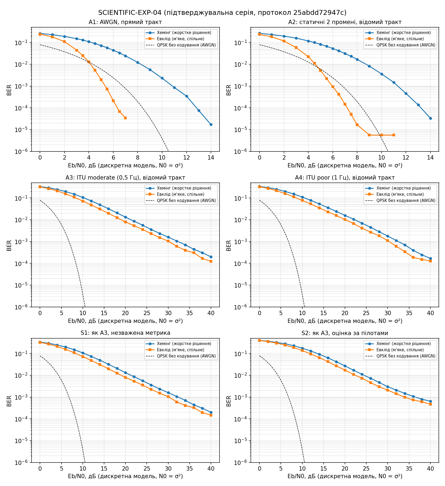

# SCIENTIFIC-EXP-04 — результати підтверджувальної серії

Статус: **COMPLETED — CONFIRMATORY**. Протокол заморожено до запуску:
`configs/SCIENTIFIC_EXP_04_PROTOCOL.json`, SHA-256
`25abdd72947c33754dc4fd04bf9b0e5b45d517ed10d45a22a8cec6fce99801d4` (файл
`.sha256` поруч). Поле `"status": "DRAFT_PENDING_APPROVAL"` усередині JSON
лишилося з моменту заморожування й не змінювалося, бо будь-яка правка змінила б
дайджест. Факт заморожування фіксує sidecar-файл.

Дизайн і гіпотези описано в `SCIENTIFIC_EXP_04_PROTOCOL_UK.md`. Сирі дані
лежать у `outputs/scientific_exp04/studies/exp04-*`. Аналіз —
`outputs/scientific_exp04/analysis.json`. Точки кривих і перерахунок —
`outputs/scientific_exp04/report_points.json`. Рисунки та CSV — у
`docs/figures/exp04/`.

`paper_exact = false`. 1,5 дБ статті тут лише для опису, нічого під нього не
підганялося.

## 1. Виконання і цілісність

| Перевірка | Результат |
|---|---|
| Комірки | 6/6 `completed`, жодна не зупинена бюджетом часу |
| Кадри | 99 200 (A1, A2 — по 7600; A3, A4, S1, S2 — по 21 000). Оцінка «119 200» у полі `array_storage.reason` замороженого JSON — арифметична помилка опису протоколу; на дизайн вона не впливає, файл не змінювався, щоб зберегти SHA-256 |
| Протокол у кожному записі | `protocol_sha256 = 25abdd72…99801d4`, `phase = confirmatory`, `common_random_numbers = true` |
| Цілісність масивів | SHA-256 кожного NPZ перевірено під час аналізу (`_read_trial_records`) |
| Незалежний перерахунок помилок | біти з опорних і декодованих пар у NPZ перераховано для обох гілок у всіх 99 200 кадрах; **0 розбіжностей** з лічильниками JSON (`scripts/report_exp04.py`) |
| Парність | у кожному кадрі хеші спостереження й виходу фронтенду однакові для обох гілок |
| Перший запуск | зупинено через інфраструктурну помилку (квадратичне перехешування маніфесту). Він збережений окремо в `outputs/scientific_exp04/aborted_run1/` і в аналіз **не входить**. Серію перезапущено з нуля на виправленому коді без змін протоколу |

## 2. Головний результат: виграш Евкліда над Хемінгом

Виграш дорівнює Eb/N0(Хемінг) − Eb/N0(Евклід) при цільовому BER. ДІ 95 % —
парний bootstrap по кадрах-кластерах зі спільними кластерами для всіх точок
Eb/N0, 5000 повторів, seed 404404. Частка валідних bootstrap-перетинів
становить 1,00 скрізь, крім S2 при 10⁻³ (0,96).

| Комірка | 5·10⁻² | 10⁻² | 10⁻³ |
|---|---|---|---|
| **A1** AWGN, прямий тракт | 2,89 [2,85; 2,94] ✓ | 4,12 [4,06; 4,18] ✓ | **5,51 [5,36; 5,64] ✓** |
| **A2** статичні 2 промені, відомий тракт | 2,96 [2,92; 3,01] ✓ | 4,15 [4,09; 4,23] ✓ | **5,37 [5,22; 5,52] ✓** |
| **A3** ITU moderate 0,5 Гц, відомий тракт | 2,16 [2,05; 2,25] ✓ | **2,30 [2,10; 2,47] ✓** | 2,15 [1,69; 2,83] ~ |
| **A4** ITU poor 1 Гц, відомий тракт | 2,05 [1,96; 2,14] ✓ | **2,16 [1,95; 2,35] ✓** | 2,18 [1,85; 2,60] ✓ |
| S1 як A3, незважена метрика | 2,16 [2,05; 2,25] ✓ | 2,30 [2,11; 2,47] ✓ | 2,14 [1,71; 2,82] ~ |
| S2 як A3, оцінка каналу за пілотами | 1,93 [1,85; 2,00] ✓ | 2,05 [1,85; 2,22] ✓ | 2,56 [1,92; 3,10] ~ |

Позначки:

* значення в дБ;
* жирним виділено первинну ціль комірки;
* ✓ — `PRECISION_CRITERIA_MET`;
* ~ — `INSUFFICIENT_PRECISION`: напівширина ДІ понад 0,5 дБ, хоча нижня межа ДІ все одно вище нуля.

Потрібне Eb/N0, дБ (Евклід / Хемінг):

| Комірка | 5·10⁻² | 10⁻² | 10⁻³ |
|---|---|---|---|
| A1 | 2,87 / 5,77 | 4,14 / 8,26 | 5,34 / 10,85 |
| A2 | 3,16 / 6,12 | 4,57 / 8,73 | 5,96 / 11,33 |
| A3 | 11,78 / 13,94 | 19,01 / 21,31 | 30,15 / 32,30 |
| A4 | 12,30 / 14,35 | 20,13 / 22,28 | 30,33 / 32,51 |
| S1 | 11,77 / 13,94 | 19,01 / 21,31 | 30,16 / 32,30 |
| S2 | 15,22 / 17,14 | 22,44 / 24,49 | 33,91 / 36,48 |

Довідково: QPSK без кодування в AWGN потребує 1,31 / 4,32 / 6,79 дБ.



## 3. Висновки за гіпотезами

**H1 (первинна) — ПІДТВЕРДЖЕНО.** У всіх чотирьох первинних комірках при
первинному цільовому BER нижня межа 95 % ДІ виграшу більша за нуль, і критерії
точності виконано:

* A1 — 5,51 дБ;
* A2 — 5,37 дБ;
* A3 — 2,30 дБ;
* A4 — 2,16 дБ.

Спільні демодуляція й декодування з м'якою евклідовою метрикою потребують
меншого Eb/N0, ніж роздільні жорстке рішення 8PSK і Вітербі з метрикою
Хемінга. Це стосується як прямого тракту, так і відомого тракту з
багатопроменевістю та доплерівськими завмираннями.

**H2 (описова) — зважування Σ|ĥ|² не погіршує, але й практично не покращує.**
S1 і A3 мають ідентичні спостереження та ідентичну гілку Хемінга (той самий
seed). Різниця необхідного Eb/N0 Евкліда не перевищує 0,01 дБ при 5·10⁻² і
10⁻². Причина в тому, що за 0,5 Гц час когерентності (~0,75 с) у тисячі разів
довший за вікно Вітербі (η = 20 елементів, ≈ 8 мс). Вага P_k у межах вікна
майже стала й однаково масштабує всі шляхи, тому рішення не змінюються. Вага
стала б помітною при швидких завмираннях або з перемежуванням. У цьому
експерименті такі умови не досліджувалися.

**H3 (описова) — виграш зберігається в практичному тракті.** З причинною
оцінкою каналу за пілотами (S2) виграш становить 2,05 [1,85; 2,22] дБ при 10⁻²
і 1,93 [1,85; 2,00] дБ при 5·10⁻². Неточність оцінки каналу коштує обом гілкам
приблизно однаково: близько 3,4 дБ Евкліду і 3,2 дБ Хемінгу при 10⁻² відносно
A3.

## 4. Інтерпретація

1. **AWGN і статика: виграш зростає зі зменшенням BER** — 2,9 → 4,1 → 5,5 дБ.
   Евклідова гілка використовує вільну евклідову відстань коду (d² = 4 за
   паралельними переходами). Жорстке рішення відкидає надійність символу, і
   метрика Хемінга по мітках 8PSK, відмінних від Грея, погано відображає
   евклідову близькість. Тому крива Хемінга має менший нахил.
2. **Хемінг гірший за QPSK без кодування за будь-якого Eb/N0 в AWGN.** При
   10⁻³ він програє QPSK 4,06 дБ (10,85 проти 6,79). Евклід виграє в QPSK
   1,45 дБ (5,34 проти 6,79), а точку перетину проходить біля 4 дБ (BER ≈
   1,3·10⁻²). Отже, кодування TCM дає енергетичний виграш лише разом зі
   спільним м'яким декодуванням. Це головний аргумент на користь спільної
   демодуляції й декодування.
3. **Завмирання: криві паралельні, виграш сталий, близько 2,2 дБ.** Без
   перемежування кадр 0,21 с охоплює менше одного завмирання. Обидві гілки
   мають порядок рознесення 1 (≈ 10 дБ на декаду), і помилки визначаються
   глибокими провалами, у яких відмовляють обидві. Евклід зсуває криву, але
   не змінює нахил. Тому виграш при 10⁻² у завмираннях (2,2–2,3 дБ) менший,
   ніж в AWGN (4,1 дБ). ITU poor (1 Гц) дає майже ті самі значення, що й
   moderate.
4. **A2: залишкова подія.** В A2 при 9–11 дБ є ненульовий BER Евкліда
   5,6·10⁻⁶. Це один кадр (індекс 377, 2 біти на 896), повторений у трьох
   точках через спільні випадкові числа: та сама реалізація шуму при більшій
   амплітуді. Це окрема подія, а не поріг помилок, і на оцінки при цільових
   BER вона не впливає.

## 5. Порівняння з 1,5 дБ статті (лише описово)

Стаття повідомляє приблизно 1,5 дБ при частоті помилок близько 5·10⁻². Сенс
p′ₙ і умови каналу не з'ясовано: SCI-05 і SCI-06 мають статус OPEN. За цим
протоколом ізольована заміна метрики при 5·10⁻² дає:

* 2,9 дБ — AWGN і статика;
* 2,0–2,2 дБ — завмирання з відомим трактом;
* 1,9 дБ — тракт з оцінкою за пілотами.

Усі значення більші за 1,5 дБ, найближче — практичний pilot-тракт. Можливі
причини розбіжності:

* інший опорний приймач у статті — повний приймач, а не ізольована метрика (у
  EXP-03B повна система в AWGN дала 1,67 [1,29; 2,00] дБ);
* інші параметри каналу;
* інше визначення енергетичної осі;
* відмінні від реконструйованих кодер і маркування (SCI-02).

Формулювання для дисертації: «отриманий виграш того самого знака і порядку,
що й у статті. Точні умови статті не відтворено, тому числова збіжність не
стверджується».

## 6. Обмеження

* Затримки ITU (0,5–2 мс) не відтворено: другий промінь має затримку 3
  відліки, а комбайнер «чистого хвоста» вимагає D < 8.
* «Відомий тракт» означає точні коефіцієнти каналу (genie CSI). Практичний
  випадок представлено лише коміркою S2 (ITU moderate).
* Перемежування немає. Висновки щодо завмирань стосуються кадру ≈ одного
  завмирання.
* Eb/N0 валідовано для дискретної AWGN-моделі (`EBN0_VALIDATION_UK.md`).
  Фільтри, синхронізацію та форму імпульсу не моделювали.
* Кодер і маркування є реконструкціями проєкту (SCI-02). Відстані коду
  збігаються з оптимальним 4-станним кодом Унгербоека.
* Цілі з позначкою ~ (10⁻³ у A3, S1, S2) мають позитивну нижню межу ДІ, але
  не відповідають критерію точності ±0,5 дБ. Для них потрібно більше кадрів у
  зоні 28–40 дБ.

## 7. Відтворення

```bash
python scripts/run_scientific_exp04.py run --approve 25abdd72947c33754dc4fd04bf9b0e5b45d517ed10d45a22a8cec6fce99801d4
python scripts/run_scientific_exp04.py analyze      # ≈ 23 хв (перевірка SHA-256 усіх NPZ + 5000 bootstrap)
python scripts/report_exp04.py                      # криві, CSV, незалежний перерахунок
```
